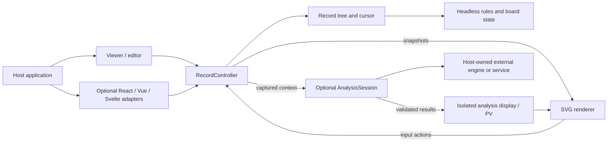

# Architecture

- Status: M1-M4 common SDK and consumer implementation complete in the recorded
  coverage; see the [delivery audit](docs/engineering/10-delivery-audit.md)
- Decision: [ADR 0001](docs/adr/0001-initial-architecture-boundaries.md)
- Framework support: [ADR 0004](docs/adr/0004-framework-independent-adapters.md)
- Initial contracts: [ADR 0005](docs/adr/0005-initial-api-record-and-package-contracts.md)
- Capability scope: [Product specification](docs/product/02-spec.md)

## Technology Direction

| Surface               | Initial choice                                                                | Purpose                                                       |
| --------------------- | ----------------------------------------------------------------------------- | ------------------------------------------------------------- |
| Board state and rules | Pure TypeScript                                                               | Shared browser/server behavior and typed contracts            |
| Records               | TypeScript SGF parser/serializer and variation model                          | Record preservation and headless navigation                   |
| Default rendering     | SVG and CSS                                                                   | Themes, annotation layers, input and vector export            |
| Framework integration | Framework-independent controller; optional React, Vue, and Svelte adapters    | Plain web embedding and framework-specific lifecycle bindings |
| Distribution          | Vite library builds, ESM/types and browser script output                      | Selective imports and simple embedding                        |
| Development           | Bun package/script workflow                                                   | Convenient development on Windows and other platforms         |
| AI integration        | Provider-neutral session, checked host-owned KataGo JSON and isolated display | Analysis display without bundling an AI engine                |

Compatibility evidence for Node 24, React 19, Vue 3 and Svelte 5 is recorded in the
[SDK contract](docs/sdk/compatibility.md); broader floors remain unclaimed. Tooling
uses Bun 1.x, TypeScript 7.x and Vite 8.x. Public exports are documented; future
extension symbols remain UNDECIDED.
Bun is a development choice,
not a required runtime for SDK consumers. Make is not required for the planned
developer workflow.

## Module Boundaries

Use one repository with one common SDK package and three separate optional React,
Vue and Svelte adapter packages. M1 delivers the common SDK; M2 adds adapters.
Local package identifiers/entrypoints are documented in the SDK contract; registry
ownership/publication remain separate. The logical modules are core, SGF/records, SVG rendering,
viewer/editor, optional framework adapters, puzzles, scoring, and analysis adapters.

Core owns legal state transitions. Records own metadata and branches; a cursor
selects the active path and derives its board through the core. A controller owns
the active record, cursor and edit history; navigation and edit Undo/Redo are
distinct operations. Renderers consume snapshots and emit input actions. Host
applications own persistence, multiplayer
authority, credentials, and remote services.

Framework adapters bind lifecycle, configuration, events and read-only snapshots
to the same controller and renderer. They do not reimplement SVG drawing, rules,
or record state. Each adapter owns only its host bindings and an SDK mount container;
the framework and SDK must not both mutate the renderer-owned DOM subtree.

## Optimization Policy

Start with TypeScript and SVG. Measure large record navigation, many thumbnail
boards, and frequent analysis overlays on representative devices. Add a Canvas
renderer or worker for a demonstrated limitation. Consider Rust/WASM only for a
specific computational bottleneck after simpler options are evaluated.

## Detailed Contracts

- [System boundary](docs/architecture/00-system-boundary.md)
- [Domain model](docs/architecture/01-domain-model.md)
- [Runtime flow](docs/architecture/02-runtime-flow.md)
- [Quality attributes](docs/architecture/03-quality-attributes.md)
- [Public API direction](docs/sdk/public-api.md)
- [Compatibility](docs/sdk/compatibility.md)
