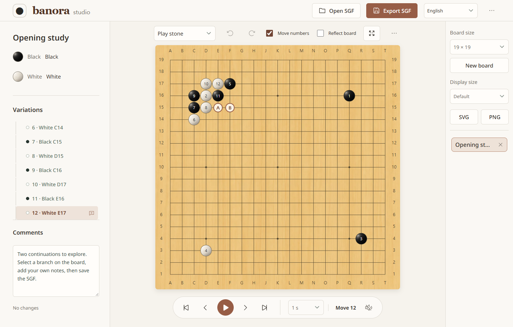
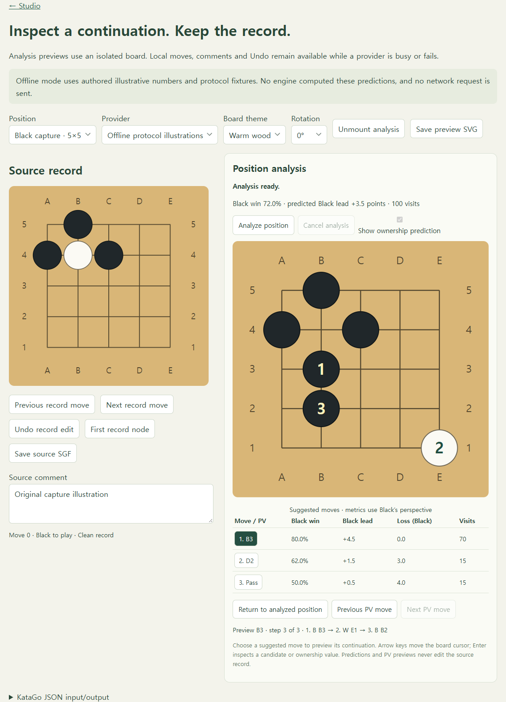

# Banora

**Go boards, SGF editors, and analysis interfaces for TypeScript.**

Build a Go (Baduk / Weiqi) application with a framework-independent SDK:
board rendering, game rules, records, and ready-to-mount widgets.
Use it in the browser, on Node.js, or through optional React, Vue, and Svelte adapters.

[**Try Banora Studio**](https://0disoft.github.io/banora/studio/) ·
[Quick start](#quick-start) · [Examples](#examples) ·
[API documentation](docs/sdk/README.md) ·
[Latest release: 0.1.3](https://github.com/0disoft/banora/releases/tag/v0.1.3)

[](https://0disoft.github.io/banora/studio/)

_Banora Studio: open a record, explore its branches, add notes, and save your work._

## What can you build?

| Build                  | Included                                                                                           | Try it / learn more                                    |
| ---------------------- | -------------------------------------------------------------------------------------------------- | ------------------------------------------------------ |
| **SGF editor**         | Variations, comments, annotations, Undo/Redo, replay, local drafts, and SVG/PNG export.            | [Studio](https://0disoft.github.io/banora/studio/)     |
| **Embedded viewer**    | A board, move navigation, variations, and comments in one mount. Optional editing.                 | [Viewer](https://0disoft.github.io/banora/viewer/)     |
| **Custom board UI**    | Themes, textures, move numbers, transforms, keyboard/touch input, and host-owned state.            | [Controlled boards](docs/sdk/controlled-board.md)      |
| **Teaching exercises** | Authored answer trees, responses, hints, restart, and outcome events.                              | [Puzzles](https://0disoft.github.io/banora/puzzle/)    |
| **Analysis interface** | Candidate metrics, ownership, and isolated principal-variation previews from an external provider. | [Analysis](https://0disoft.github.io/banora/analysis/) |
| **Headless tools**     | SGF operations, legal moves, scoring, and structured JSON automation.                              | [CLI guide](packages/cli/README.md)                    |

The SDK includes SGF import/export, setup stones, captures, simple ko and optional
superko policies. Manual agreed-position scoring supports Japanese, AGA, and
Tromp-Taylor counting. [Rules and scoring boundaries](docs/sdk/public-api.md#manual-agreed-position-scoring)
remain explicit; an analysis engine is an optional host integration.

## Quick start

Install the SDK in a browser project using Node 24.x:

```sh
npm install @0disoft/banora
```

Add a container:

```html
<div id="viewer"></div>
```

Mount an editable viewer in your application's TypeScript entry point:

```ts
import { mountViewer } from '@0disoft/banora';

const viewer = mountViewer(document.getElementById('viewer')!, {
  sgf: '(;FF[4]GM[1]SZ[9];B[cc];W[gg])',
  editable: true,
  variationMode: 'focused',
});

// Call viewer.dispose() when your application removes this view.
```

The viewer owns its controller when one is not supplied. You can also share a
`RecordController`, mount only a board, or use headless modules independently.
See the [SDK quick start](packages/sdk/README.md) and
[public API](docs/sdk/public-api.md).

## Packages

Install the SDK plus the adapter your application uses. All five packages are
published at **0.1.3** on npm's default channel.

| Package                                                                          | Purpose                                                                                   | Guide                               |
| -------------------------------------------------------------------------------- | ----------------------------------------------------------------------------------------- | ----------------------------------- |
| [`@0disoft/banora`](https://www.npmjs.com/package/@0disoft/banora)               | Core rules, SGF, controller, SVG board, and widgets. No third-party runtime dependencies. | [SDK](packages/sdk/README.md)       |
| [`@0disoft/banora-react`](https://www.npmjs.com/package/@0disoft/banora-react)   | React components and hooks.                                                               | [React](packages/react/README.md)   |
| [`@0disoft/banora-vue`](https://www.npmjs.com/package/@0disoft/banora-vue)       | Vue components and composables.                                                           | [Vue](packages/vue/README.md)       |
| [`@0disoft/banora-svelte`](https://www.npmjs.com/package/@0disoft/banora-svelte) | Svelte components and state integration.                                                  | [Svelte](packages/svelte/README.md) |
| [`@0disoft/banora-cli`](https://www.npmjs.com/package/@0disoft/banora-cli)       | Terminal commands and JSON requests/responses.                                            | [CLI](packages/cli/README.md)       |

Current compatibility targets are **Node 24, React 19, Vue 3, and Svelte 5**.
Compatible 0.1 updates preserve the public contract; breaking pre-1.0 changes
require a new minor and migration notes. See the
[compatibility matrix](docs/sdk/compatibility.md) and
[release evidence](docs/engineering/36-maintenance-release.md).

## Examples

| Start with                  | Live example                                                                                                                                         | Source / guide                                                                                        |
| --------------------------- | ---------------------------------------------------------------------------------------------------------------------------------------------------- | ----------------------------------------------------------------------------------------------------- |
| **Framework integration**   | [React](https://0disoft.github.io/banora/react/) · [Vue](https://0disoft.github.io/banora/vue/) · [Svelte](https://0disoft.github.io/banora/svelte/) | [React source](examples/react/) · [Vue source](examples/vue/) · [Svelte source](examples/svelte/)     |
| **A script tag**            | [Classic browser build](https://0disoft.github.io/banora/browser/)                                                                                   | [Browser example](examples/browser/)                                                                  |
| **A read-only embed**       | [Read-only board](https://0disoft.github.io/banora/readonly/)                                                                                        | [Read-only example](examples/readonly/)                                                               |
| **Your own application**    | Run the independent starter locally.                                                                                                                 | [Standalone record editor](examples/standalone/README.md)                                             |
| **An existing state model** | [Vanilla controlled board](https://0disoft.github.io/banora/controlled/)                                                                             | [Controlled Vanilla / React / Vue / Svelte](examples/controlled/README.md)                            |
| **An external engine**      | [Analysis interface](https://0disoft.github.io/banora/analysis/)                                                                                     | [Manual KataGo JSON](examples/analysis/README.md) · [Local KataGo CLI](examples/katago-cli/README.md) |

<details>
<summary><strong>Preview the analysis interface</strong></summary>



The screenshot uses the example's **authored offline fixtures**, not engine-computed
predictions. A real integration supplies its own engine and transport. Previewing
a continuation preserves the source SGF, comments, and Undo history.

</details>

## Local work, sharing, and languages

- **Local editing:** core board, rules, records, manual scoring, and authored puzzles
  work without a hosted service. Studio can save drafts in this browser and
  download portable backups. [Recovery and storage](docs/sdk/recovery.md).
- **Sharing:** embedded record, node, and static-position links need no server.
  Link data is readable, not private; export an SGF for larger records.
  [Sharing semantics](docs/sdk/public-api.md#embedded-share-links).
- **Twelve languages:** English, Chinese, Hindi, Spanish, French, Russian,
  Indonesian, Japanese, Vietnamese, Korean, Thai, and Malay. UI localization
  preserves authored comments, puzzle text, and provider messages.
  [Localization guide](docs/sdk/localization.md).

## Development

Use **Bun 1.x** and **Node 24.x** in this repository:

```sh
bun run setup
bun run dev
```

Open [localhost:4317/studio/](http://127.0.0.1:4317/studio/).

| Command                  | Purpose                                                                     |
| ------------------------ | --------------------------------------------------------------------------- |
| `bun run check`          | Types, behavior tests, documentation, builds, and packed SDK/CLI consumers. |
| `bun run smoke:browser`  | Production browser flows with Playwright CLI and a compatible browser.      |
| `bun run smoke:adapters` | Independently installed adapter types and SSR.                              |
| `bun run docs`           | Documentation links and command references.                                 |

See [Development](DEVELOPMENT.md) for setup and validation details, or
[Contributing](CONTRIBUTING.md) to work on the project.

## Documentation and support

- [SDK guides and API](docs/sdk/README.md) — modules, ownership, and consumer contracts.
- [Architecture](ARCHITECTURE.md) — responsibilities and design decisions.
- [Roadmap](docs/product/01-roadmap.md) — direction and unimplemented capabilities.
- [Documentation index](docs/README.md) — complete contracts and execution evidence.
- [Releases](https://github.com/0disoft/banora/releases) — exact prepared archives and manifests.
- [Security policy](SECURITY.md) — private vulnerability reporting.

## License

Original SDK code and documentation are [MIT licensed](LICENSE).
Studio and the framework examples include third-party fonts, icons, and runtime
dependencies with their own licenses. See the
[Studio asset notices](examples/studio/assets/README.md) before redistribution.
